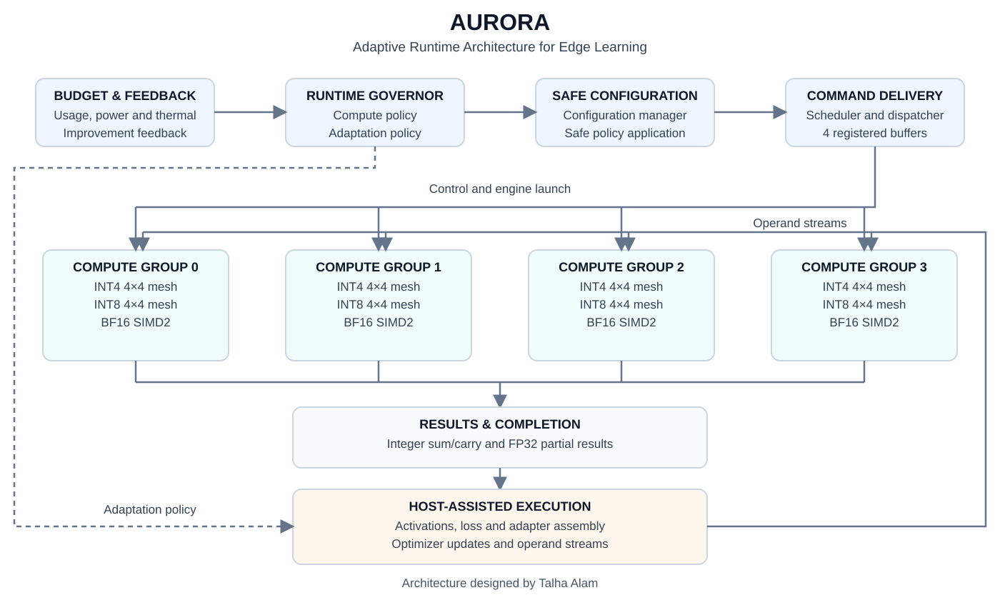

# AURORA

**Adaptive Runtime Architecture for Edge Learning**

Architecture designed by **Talha Alam**.

[Architecture](#architecture) · [Results](#results) · [Quickstart](#quickstart) · [Citation](#citation)

---

## Overview

AURORA is a mixed-precision edge-AI accelerator that coordinates compute
execution and host-assisted adaptation through runtime policies. Its
four compute groups support INT4, INT8 and BF16 workloads.

The design connects a budget-aware governor, safe configuration logic,
tile scheduling and registered command delivery to a streaming compute
fabric. This repository contains the final RTL, SKY130 mapped netlists,
timing checkpoint and saved workload validation evidence.

### Key capabilities

- **Mixed-precision execution:** dedicated INT4, INT8 and BF16 engines in each group.
- **Runtime compute control:** precision selection and compute-group allocation.
- **Adaptation policies:** rank, scope, update interval and training enablement.
- **Streaming integration:** operand readiness, output backpressure and completion handling.

## Architecture



### Compute organization

| Component | Implementation | Output |
|---|---|---|
| INT4 engine | 4×4 mesh with INT4 dot-product PEs | Carry-save integer sum/carry |
| INT8 engine | 4×4 mesh with INT8 dot-product PEs | Carry-save integer sum/carry |
| BF16 engine | SIMD2 with two DOT2 lanes | FP32 partial results |
| Compute fabric | Four mixed-precision groups | Group results and completion |
| Command interface | Four registered command buffers | Controlled group launch |

The scheduler dispatches tile jobs through registered command buffers.
Each compute group consumes operand streams and returns results through
a backpressure-aware interface. The BF16 path uses credit-managed buffering.

### Runtime adaptation

Budget, usage, power-level, thermal-level and improvement inputs feed
the governor. Its outputs control compute allocation and adaptation
policy; safe configuration logic coordinates policy application.

The learning workload is partitioned between hardware and host:

| RTL execution | Host execution |
|---|---|
| Forward matrix operations | Activations and loss |
| Classifier-gradient matrix operations | Adapter assembly |
| Runtime adaptation policy | Optimizer updates |

The demonstrated training flow uses a frozen encoder and classifier
adapters. An autonomous on-chip optimizer is outside the implemented scope.

### Exercised policies

The following operating points were tested with an emulated budget of 1024:

| Usage | Precision | Group mask | Rank | Update interval | Scope | Training |
|---:|---|---:|---:|---:|---:|---|
| 0 | BF16 | 15 | 8 | 1 | 8 | Enabled |
| 650 | INT8 | 7 | 4 | 2 | 4 | Enabled |
| 890 | INT4 | 3 | 2 | 4 | 2 | Enabled |
| 1024 | INT4 | 1 | 1 | 16 | 1 | Disabled |

Masks identify enabled compute groups. Budget inputs in these tests
are emulated rather than derived from physical energy measurements.

## Results

### SKY130 mapped checkpoint

| Metric | Result |
|---|---:|
| Library corner | SKY130 HD · TT · 1.8 V · 25°C |
| Mapped cells | 524,715 |
| Mapped cell area | 6.308714 mm² |
| Operating clock period | 4.952000 ns |
| Operating frequency | 201.939 MHz |
| Mapped timing | Closed at the operating period |

### Numerical validation

Full-system integration passed **6 jobs and 4,508 numerical checks**:
12 INT4 tiles, 12 INT8 tiles and 25 BF16 tiles. The run also exercised
837 BF16 credit-stall cycles.

Source and netlist checksums were verified when preparing the final
repository snapshot.

### Real-model smoke test

**Model:** [dacorvo/mnist-mlp](https://huggingface.co/dacorvo/mnist-mlp)  
**Workload:** four training images and four separate held-out images.

| Evaluation | Correct predictions | Loss |
|---|---:|---:|
| Training before updates | 3/4 | 0.733589 |
| Training after updates | 3/4 | 0.729053 |
| Held-out evaluation | 4/4 | Approximately 0 |

Held-out labels and predictions matched `[4, 0, 5, 6]`.
Two host-assisted adapter update steps exercised different policies.
The training-disabled policy skipped updates, and a separate BF16
real-activation kernel passed.

### INT8 forward execution

| Metric | Four-image batch |
|---|---:|
| RTL job cycles | 7,061 |
| Derived batch latency | 34.966072 µs |
| Amortized latency per image | 8.741518 µs |
| Derived accelerator throughput | 114,396.6 images/s |

**Measurement scope:** performance is derived from RTL cycles at the
mapped clock, including testbench guards and output stalls; host and
DMA time are excluded. Accuracy covers four held-out images and is a
functional smoke test. Timing and area are pre-layout mapped results.

## Project status

| Stage | Status |
|---|---|
| RTL integration and numerical validation | Completed for the documented tests |
| SKY130 synthesis and mapped timing | Completed |
| Real-model inference and adaptation smoke test | Completed |
| Physical implementation and GDSII | Next stage |
| Workload power and energy evaluation | Planned during backend evaluation |

Ultra-low-power operation has not yet been established. The repository
contains a validated RTL and mapped implementation checkpoint.

## Quickstart

Clone the repository using an account with access:

```bash
git clone https://github.com/talha-ee/AURORA.git
cd AURORA
```

Compile the integrated RTL top with Icarus Verilog:

```bash
mkdir -p build
iverilog -g2012 -s ee_runtime_compute_system \
  -o build/aurora.vvp -c release/aurora_final/rtl_sources.f
```

This performs compilation; it does not run the numerical workload.

Extract the final netlists:

```bash
gzip -dk release/aurora_final/mapped.v.gz
gzip -dk release/aurora_final/sta_compatible.v.gz
```

The build record contains source hashes and expected uncompressed
netlist hashes. Both archives preserve the original netlist bytes.

### Repository guide

| Path | Purpose |
|---|---|
| `rtl/control/` | Configuration, scheduling and command delivery |
| `rtl/governor/` | Runtime adaptation governor |
| `rtl/engines/` | Integer and floating-point compute RTL |
| `rtl/top/` | Integrated runtime and compute-system tops |
| `release/aurora_final/` | Netlists, source list and build record |
| `synth/ref_runtime_compute_system_mapped/checks/` | Closure evidence, constraints and required candidate RTL |
| `tests/workloads/hf_mnist_runtime/` | Workload bridge, runner code, results and adapters |
| `docs/aurora_architecture.svg` | Architecture overview |
| `CITATION.cff` | GitHub citation metadata |

The source list contains **28 active RTL files**, including the
compute-group stream wrapper retained under the synthesis checks directory.

### Environment notes

The flow uses Python and workload dependencies, Icarus Verilog/VVP,
Yosys, OpenSTA and matching SKY130 libraries. Cached model/data assets
and PDK libraries are external dependencies.

Historical scripts and manifests retain original VM paths. Configure
those paths and assets before running the workload or timing flow on
another machine. Retained `500mhz` filenames do not override the final
clock period recorded in the build manifest.

Mapping to a different PDK requires remapping and fresh timing and
physical validation.

## Citation

If you use AURORA's architecture, RTL or validation material, cite:

> Alam, T. (2026). *AURORA: Adaptive Runtime Architecture for Edge Learning*
> [RTL research prototype]. GitHub. https://github.com/talha-ee/AURORA

```bibtex
@misc{alam2026aurora,
  author       = {Alam, Talha},
  title        = {{AURORA}: Adaptive Runtime Architecture for Edge Learning},
  year         = {2026},
  howpublished = {GitHub repository},
  url          = {https://github.com/talha-ee/AURORA},
  note         = {RTL research prototype}
}
```

Record the commit SHA used in your experiments. Citation metadata is
available in [CITATION.cff](CITATION.cff), with a ready-to-use
[BibTeX file](CITATION.bib).
